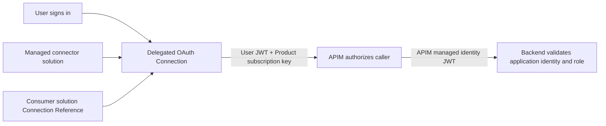

# Authentication and ALM boundaries

The custom connector's built-in OAuth grant is authorization code, not client credentials. Its Managed identity option replaces the OAuth client's secret through federation; it does not remove the user or change the frontend token into an application token.

APIM requires a valid Product subscription and validates the tenant, frontend audience, authorized connector client and `Demo.Read` delegated scope. Only then does `authentication-managed-identity` replace Authorization with APIM's backend token. The subscription key is removed before forwarding.

The connector has one OAuth security scheme and a separate required secure subscription-key Connection parameter. A documented `setheader` request policy sends that parameter as `Ocp-Apim-Subscription-Key`. This is not an OR-choice between authentication methods: APIM independently requires both.

The backend accepts Entra-signed, unexpired v2 tokens for its own audience and issuer. Authorization additionally requires the exact APIM service-principal `oid`, APIM client `azp`, `idtyp=app`, `Demo.Invoke` application role and absence of delegated/user claims (`scp`, `upn`, `preferred_username`, `unique_name`, `email`). The backend resource registration explicitly requests the optional `idtyp` claim. A `roles` claim alone is not evidence of app-only access; user tokens can contain roles too.

`/health` is anonymous and contains no identity data. `/proof` requires the application authorization policy. There is no anonymous demo fallback.

## Managed distribution

Author in a dedicated Build environment, export managed solutions and import into a different target. Import the connector solution before the consumer solution. The consumer Connection Reference points to a target-local delegated Connection; importing a solution is not a substitute for OAuth sign-in.

The target connector receives its own federation identity. Configure that identity on the connector client registration before creating the Connection. Do not assume that federation setup survives cross-environment import unchanged.

Keep the APIM-derived OpenAPI definition separate from connector authentication settings. `Export-Connector.ps1` composes the initial definition and `auth-overlay.json`. Once Managed identity is configured, preserve the platform's persisted authentication properties. In the live test, PAC cleared request-policy templates when an update omitted `--api-properties-file`; `Update-ConnectorDefinition.ps1` therefore downloads the current properties and passes them unchanged alongside the new definition, then checks the persisted security fields before solution promotion. Never reuse the initial auth overlay for an existing federated connector.

Compatible updates keep operation IDs, paths, authentication requirements and existing response fields stable. Compare connector authentication fingerprints and Connection/Reference identifiers, then run the same flow again. Breaking changes require a separately versioned operation and explicit consumer migration.

The live compatible update preserved the original Connection without reauthentication, but exposed a crucial boundary: a target-local Active customization masked the new managed definition and held the target's distinct OAuth redirect/federation subject. After approved removal, the managed definition became effective but exposed Build's OAuth metadata. The platform team restored only the recorded target redirect/subject, with a guard requiring the entire OAuth/key parameter JSON to match its original target fingerprint. The real flow then returned HTTP 200 again. Local configuration layers are therefore not uniformly disposable: distinguish necessary environment-specific federation from accidental edits, and reapply it reproducibly. Do not promise that managed import alone updates every effective connector or preserves cross-environment federation.

## What this does not establish

The example does not make generic connector OAuth app-only, automate delegated sign-in without consent, demonstrate every canvas app/Dynamics UI scenario, prove private APIM networking, or force Catalog updates on existing installations. Those are separate capabilities or restrictions.

Managed properties have connector-specific limitations; a managed solution is not a guarantee that every local customization is prohibited. Catalog requires its own prerequisites and installation/update lifecycle.
