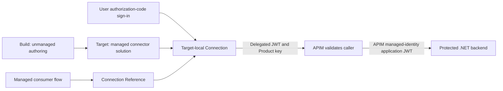

# Contoso connector PoC: implementation, decisions and verified results

Names, resource URLs and runtime identifiers in this historical report use illustrative Contoso replacements; deployed resources were not renamed. See the [repository naming note](../README.md) before using this evidence with a live deployment.

## Outcome and scope

On 5 November 2026, a real managed Power Automate flow invoked an Azure API through a centrally authored Custom Connector, before and after a compatible connector update. Both runs returned HTTP 200 using the same target-local Connection and Connection Reference, without reauthentication between the runs.

The demonstrated security boundary is **delegated user OAuth plus an APIM Product subscription key into APIM, followed by APIM's application identity into the backend**. This is not an app-only generic Custom Connector, not a complete unattended Azure DevOps execution, and not a production-readiness certification.

The user chose to retain the deployment. The [README inventory](../README.md#retained-demo-inventory) contains the actual resource names, approved subscription/tenant, regions, environment IDs/URLs and solution links. This report preserves selected non-secret evidence rather than copying ignored local state, credentials, response headers, tokens or cookies into Git.

## The original four Contoso steps

| Contoso requirement | What was implemented and observed | Boundary of the result |
|----------------|----------------------------------|------------------------|
| 1. INET exposes APIs through APIM, Product access plus JWT and backend authorization | Published Product `contoso-developers`, subscription-required API `contoso-proof`, approved demo subscription, delegated JWT validation at APIM, then exact APIM managed-identity authorization at the backend. A real flow reached the backend; six live rejection cases also passed. | The connector-side JWT is delegated, not client credentials. Product and subscription were provisioned for the demo; a human Developer Portal request/approval journey was not exercised. |
| 2. PPE centrally manages the connector and keeps Power Platform authentication settings during API updates | Separate OpenAPI/auth overlay, persisted-property update helper, federation per environment, policy/security guards and an effective-definition check. Definition `1.0.0` became `1.0.1`. | A bare PAC definition update dropped policy templates. A bare managed import did not safely preserve the target-local federation configuration. Guarded correction was required. |
| 3. PPE distributes versioned managed solutions with controlled dependencies | Dedicated Build environment; separate connector and consumer solutions imported managed into a distinct target. Consumer upgrade removed accidental duplicate connector ownership. | Managed connector limitations and an Active layer mattered. Catalog submission/installation and forced downstream updates were not demonstrated. |
| 4. Teams use local Connections and Connection References across environments | User completed initial delegated OAuth and repaired the existing Connection; managed consumer bound the target reference to that same Connection. It survived the verified compatible update and real rerun. | No credential-free unattended initial user Connection provisioning was proven. Canvas/Dynamics integration and a full DTAP rollout were not tested. |

## What was built, and why



### Three Entra applications and two distinct trust boundaries

| Application | Client/application ID | Purpose and permission |
|-------------|-----------------------|------------------------|
| `contoso-connector-poc-frontend` | `53e6452e-d324-43dc-88ce-3574065eba43` | Represents the APIM-facing resource; exposes delegated scope `Demo.Read` and requests v2 access tokens. |
| `contoso-connector-poc-connector` | `beee3752-ec52-40a0-a7ab-f7c5d325a28c` | Single-tenant OAuth client with delegated `Demo.Read` permission and tenant-wide admin consent. Source and target have separate federated credentials/redirects. No client secrets were created. |
| `contoso-connector-poc-backend` | `4f6f0bbe-dbc3-48f4-87d2-1b48e185167c` | Represents the protected backend; exposes application-only role `Demo.Invoke`, requests v2 tokens and explicitly configures optional access-token claim `idtyp`. |

APIM's system-assigned service principal has object ID `0806dff9-cfb4-4ca1-b5b1-03105ae848b7` and client ID `49ee4977-6f1e-4524-9f08-3a38e255f08c`. That principal receives `Demo.Invoke` on the backend resource. The connector client does not receive this backend role as a shortcut around APIM.

Generic Custom Connector built-in OAuth does not support native `client_credentials`. Its **Managed identity** option replaces the delegated OAuth client's secret using federation; it does not eliminate the user's authorization-code sign-in or turn that token into an application token. This distinction dictated the architecture instead of attempting an unsupported grant. [Microsoft references](sources.md) underpin the design.

APIM requires the subscription key and validates the delegated token's tenant, audience, allowed connector client and `Demo.Read` scope. Only after caller authorization does `authentication-managed-identity` obtain a backend token. APIM replaces Authorization and removes the Product key before forwarding. This is an intentional identity boundary: the backend trusts APIM, so APIM must authorize the original caller rather than become an unrestricted relay.

The .NET backend validates Entra signature, issuer, audience and expiry. It additionally requires the exact APIM `oid` and `azp`, `Demo.Invoke`, configured `idtyp=app`, and absence of delegated/user claims: `scp`, `upn`, `preferred_username`, `unique_name` and `email`. **A roles claim alone does not establish app-only access**, because delegated tokens can also contain roles. `/health` is anonymous and non-sensitive; `/proof` is protected.

### Subscription-key handling

The connector uses one OAuth security scheme plus a separate required `securestring` parameter `api_key`. Its request `setheader` policy injects:

```text
Ocp-Apim-Subscription-Key = @connectionParameters('api_key', '')
```

This is not an OR-choice between OAuth and the key: APIM requires both. The key is entered directly into the Connection, not committed to source or supplied through ordinary Connection Reference deployment settings. The demo proves key-plus-OAuth runtime behavior; it does not prove a complete central secret-distribution/rotation service that hides Product keys from every team.

### Infrastructure and environment separation

Bicep creates APIM Developer, a Linux B1 App Service plan and a .NET 10 backend in the isolated resource group. Scripts bootstrap the demo-owned Entra registrations, grant the backend role to APIM, deploy backend code and configure the API/Product/policies. Explicit tenant/subscription checks avoid inheriting unrelated CLI defaults. Demo ownership checks prevent silently reusing unrelated resources.

Two Developer environments separate unmanaged authoring from actual managed consumption. This prevents a successful authoring test from masquerading as distribution proof and exposes cross-environment federation/dependency behavior. The target contains managed solutions, but **Managed Environment licensing was not enabled**. Existing unrelated environments were left untouched.

## Regional and provisioning decisions

The original Azure choice was West Europe. Provider provisioning validation exposed new-customer eligibility there; North Europe, France Central and Germany West Central encountered B1 quota restrictions. Advertising a SKU or reporting general regional capacity was therefore not accepted as proof of deployment eligibility.

At the user's request, the same subscription-scope ARM validation covered APIM Developer, Linux B1 and the web app in three additional regions. Each command explicitly overrode the parameter-file location, rather than relying solely on deployment metadata location:

```powershell
az deployment sub validate --subscription 17254a3c-2e67-4fec-9e2c-cfe17cfb579d `
  --location <region> --template-file .\infra\deployment.bicep `
  --parameters .\out\validation.local.json location=<region>
```

| Effective resource and deployment location | Saved result |
|-----------------------------------------------------|--------------|
| `swedencentral` | `Succeeded`, no validation error |
| `italynorth` | `Succeeded`, no validation error |
| `polandcentral` | `InternalSubscriptionIsOverQuotaForSku`; B1 limit 0, usage 0, required 1 |

The user selected **Sweden Central**, retaining the approved APIM Developer/B1 design and cost basis. No Container Apps or paid quota fallback was silently substituted.

Power Platform initially required exact Europe. PAC `--region europe` failed macro-region validation; the official administration cmdlet with `-LocationName europe` returned `MacroRegionRequired`. The admin UI exposed macro-geographies with capacity-selected placement rather than an exact Europe selector. An initially created, empty mismatched Build environment was deleted only after exact-ID/content checks and specific user approval; it is not one of the retained environments.

The user subsequently explicitly accepted **European Union & EFTA, including possible Switzerland placement**. Two Developer environments with Dataverse were created through the authenticated admin UI under existing entitlement. Actual returned placement was verified before components: Build in Switzerland North and target in Switzerland West. No paid fallback was used. This is an approved geography change, not a claim that `eu-efta` guarantees exact Europe.

## Connector, federation, solutions and first execution

The APIM-derived OpenAPI contract and initial Power Platform auth overlay are separate source artifacts. Source connector creation was followed by Managed identity configuration in the Security UI using the tenant GUID, not `common`. The platform-provided federation issuer/subject and redirect were registered on the connector OAuth client.

Import into the target produces a distinct runtime identity. Source runtime API name ends `5febfe6c1bbe786875`; target runtime API name is `shared_new-5fcontoso-20connector-20proof-5fdbb3081242d45d19`. Target federated credential `contoso-poc-target` and its target redirect were registered separately from `contoso-poc-build`. No cookies/tokens were transferred between browser sessions.

`ContosoPoCConnector` owns the central connector. `ContosoPoCConsumer` owns the manually triggered **Contoso Identity Boundary Proof** flow and `contoso_ContosoProofConnection`. The reference includes the connector dependency lookup and is bound on target import through deployment settings to an existing environment-local delegated Connection. The connector is imported before consumer activation.

Initial OAuth consent/Connection setup was interactive. The embedded browser blocked an authentication popup, so the user used their ordinary browser. The existing matching Connection initially reported Error/Reconnect, was repaired by its owner, and was independently observed as Connected before binding. No Connection was deleted or recreated. Connected was only a prerequisite; the real flow invocation supplied the positive end-to-end proof.

## ALM failures, why they mattered, and guarded corrections

| Observed issue | Risk / why it was not ignored | Correction and verification |
|----------------|------------------------------|-----------------------------|
| Security UI save removed custom `api_key`, though header policy remained | OAuth could appear configured while the Connection could not supply the required Product key. | `Restore-ConnectorSubscriptionParameter.ps1` downloaded persisted Managed identity properties, restored only the key parameter, supplied the definition and checked OAuth unchanged. Corrected initial managed version was `1.0.0.1`. |
| PAC `2.12.2+ga6b1ffa` definition update omitted `--api-properties-file` and persisted `policyTemplateInstances=[]` | Key parameter and OAuth survived, but no request policy remained to send the key. | Source guard rejected promotion before version bump. Repaired source from preserved properties; updater now always downloads current properties and passes them unchanged with the new definition. Regression rejects the observed empty-policy mutation. |
| Consumer package included connector root component type `372`, despite `--AddRequiredComponents false` | The consumer acquired another managed connector layer and undermined central ownership/update ordering. | Removed only source consumer solution membership after checking central ownership; package guard rejects `Connector/` artifacts in consumer ZIP. Consumer `1.0.1.0` was staged/upgraded to remove its obsolete target layer, not merely imported as an update. |
| Connector solution became `1.0.1.0`, but effective definition stayed `1.0.0` | A green import/version check would have falsely declared update success. | Effective-definition hash/contract check failed. Live Solution Layers showed Active unmanaged above the consumer and connector layers; after consumer correction only Active and central connector remained. |
| Approved removal of only that connector's Active customization exposed Build's OAuth redirect/subject | The layer was not just an accidental local edit: target-specific federation configuration was load-bearing. Entra target credential still existed, but effective connector identity metadata changed. | Security guard stopped before rerun; obtained separate user approval. `Restore-TargetFederationMetadata.ps1` changed only recorded target redirect/subject while retaining the effective `1.0.1` definition and header policy. The complete restored OAuth/key JSON had to match the original target SHA256 before application. |
| PAC/import normalized definition serialization and policy wrapper casing | Raw hashes can distinguish harmless representation changes from real changes only with an explicit, narrow comparison. | Full JSON semantic equality checks definition preservation during restoration. Policy comparison normalizes only known wrapper names (`templateId`, `title`, `parameters`), rejects unknown wrapper fields, and retains all parameter names/values. OAuth/key parameter hash matches baseline exactly. |

**Environment-specific local identity configuration is load-bearing.** Its restoration may recreate an Active layer. This PoC does not establish that a bare managed import preserves it, that every Active layer is safe to remove, or that a generic force-overwrite is an acceptable production deployment strategy. The individually approved repair did not delete the connector, Connection, flow or environments.

### The repaired update procedure

The exact command pattern and prerequisites are in the [deployment guide](deployment.md#observed-pac-update-failure-and-repair). The essential source update is:

```powershell
.\scripts\Update-ConnectorDefinition.ps1 @BuildParameters `
  -ConnectorId 5efda2d4-20d9-f111-84e8-70a8a5079ecf `
  -ApiDefinitionPath .\out\connector-update\apiDefinition.json `
  -SolutionVersion 1.0.1.0
```

It downloads persisted properties and invokes `pac connector update` with **both** `--api-definition-file` and `--api-properties-file`, then compares persisted authentication/parameter/policy fields before changing the solution version. `New-CompatibleDefinition.ps1` generates the compatible version/description change without changing `GetProof`, host or base path.

Export publishes the isolated source and validates package ownership. Before promotion, capture target identifiers, effective definition, security fingerprints and environment-specific federation. After import, inspect effective layers rather than automatically discarding them. Any required layer removal/restoration is a separately approved action, followed by the target restoration helper, snapshot comparison, independent Entra verification and a real run using the original Connection.

`Test-ConnectorUpdateGuard.ps1` passes unchanged metadata and rejects policy loss. `Test-ManagedUpdateGuard.ps1` rejects version-only success, source OAuth substitution, replacement Connection and lost header policy. These regressions exercise guard logic; they are not substitute live flow runs.

## Curated before/after evidence

Both actual runs used workflow `6c551e3f-21d9-f111-84e8-70a8a5079ecf` in target `9428be14-6fc4-e1a0-9f36-28db26e7b952`.

| Observation | Baseline | After compatible update and approved identity restoration |
|-------------|----------|-----------------------------------------------------------|
| Real run | [08584077183106224027230767590CU28](https://make.powerautomate.com/environments/9428be14-6fc4-e1a0-9f36-28db26e7b952/solutions/~preferred/flows/6c551e3f-21d9-f111-84e8-70a8a5079ecf/runs/08584077183106224027230767590CU28) | [08584077153898941665765164881CU11](https://make.powerautomate.com/environments/9428be14-6fc4-e1a0-9f36-28db26e7b952/solutions/~preferred/flows/6c551e3f-21d9-f111-84e8-70a8a5079ecf/runs/08584077153898941665765164881CU11) |
| Start/end on 2026-11-05, UTC+01 | 15:22:55-15:23:00 | 16:11:35-16:11:36 |
| Flow / `GetProof` | Succeeded / HTTP 200 | Succeeded / HTTP 200 |
| Managed connector solution | `1.0.0.1` | `1.0.1.0` |
| Effective definition | `1.0.0` | `1.0.1`, changed summary/description; stable operation contract |
| Original Connection | `a70df4ce-b90d-43c4-9f07-5119-03bc0036` | Same; no Reconnect/reauthentication since baseline |
| Connection Reference | `616ee0b0-092b-4313-9a4a-443ba727ec62` | Same, logical name `contoso_ContosoProofConnection` |
| Backend result | Exact APIM object/client checks true; `Demo.Invoke`; no delegated scope/user context | Same; backend remains version `1.0.0` |

The final consumer solution is managed `1.0.1.0`. Connector Dataverse component ID remains `5efda2d4-20d9-f111-84e8-70a8a5079ecf`.

Selected SHA256 evidence:

```text
Effective definition before:
B7A456EE43019DC80C67172EB9AEC07B0E669F081A63E70AF7D8935AE5ADB84F
Effective definition after:
C4D364B56782D23F606F1A02DAA2F8A92AFA49495EE005B6E2B79A08D0EE6D35
Complete OAuth/key connection parameters, before and final after:
9C0C088722C7356BBB7F689B5CE76FD40F3DD0B8F9987BB00747629271132C3C
Header policy before and normalized final after:
81588E267021828E2E53435504633F3F67E09B068D419C1E8D32775D86186956
```

Target federation and redirect were independently verified unchanged on the Entra application, with zero client secrets. The final target redirect is `https://global.consent.azure-apim.net/redirect/new-5fcontoso-20connector-20proof-5fdbb3081242d45d19`; the target subject is distinct from Build. The original snapshots, redacted run records and repair history remain ignored under `out\`; this report preserves the essential observations after transient run history expires.

### What was validated, and what was not

**Live:** deployed infrastructure/backend readiness; six rejection cases (missing/invalid Product key, missing/malformed bearer, real wrong-audience bearer, anonymous direct backend); real managed baseline and post-update runs; actual effective-definition change; stable Connection/reference; preserved OAuth/key/header policy and target federation.

**Local/unit or structural:** 20 authorization, HTTP and connector-contract tests passed. Wrong-role, wrong-client/identity and user-context rejection were unit-tested, not tested with additional live identities/tokens. APIM scope enforcement was structurally checked; a real wrong-scope token case was not executed. Update guard regressions passed, including the omitted-properties policy-loss case.

**Not demonstrated:** live Azure DevOps pipeline/WIF service-connection execution, unattended initial delegated Connection creation, service-principal-owned flow behavior, Catalog distribution/updates, canvas app Connection Reference behavior, Dynamics UI integration, environment-variable save-time reevaluation, private APIM/VNet access, complete DTAP rollout, key rotation or production governance/load/recovery.

The YAML is an **unexecuted ordered-promotion template**. It does not automate the approved target-layer investigation/restoration sequence and intentionally does not blindly remove Active customizations. Package version and Connected status alone cannot prove effective update or authorization: the guard checks actual definition and settings, then a real flow tests the entire path.

## Operating the retained demo and remaining work

Use the [README run instructions](../README.md#open-and-run-the-existing-demo) to invoke the existing target flow. Do not rerun deployment/bootstrap just to show it. Preserve the current Connection and its reference. If later authentication expires, inspect the failure and let the owner complete delegated repair where required; this proof does not promise that tokens never expire or consent never changes.

For future updates, follow the guarded [deployment procedure](deployment.md), capture new baseline evidence before changes, preserve environment-local identity settings and verify the actual changed contract plus runtime. Breaking operation changes require explicit versioning/migration rather than relying on this compatible documentation-update proof.

Production design still needs agreed caller authorization granularity, platform/tenant governance and DLP, least-privilege operational identities, secret/key lifecycle, licensing, availability/SKU selection, monitoring, recovery, change approvals and an exercised delivery pipeline. APIM Developer, B1 and Developer environments were intentionally selected for a demo, not claimed production architecture.

Resources remain in place at the user's request. The disclosed base estimate was approximately USD 0.084/hour or USD 61 per 730 hours for APIM Developer plus B1, before tax/traffic/Power Platform licensing; it is not a fresh quote or cost ceiling. Follow billing and entitlement in the actual tenant. Any cleanup requires separate approval and exact resource/content checks; no deletion or reconfiguration is authorized by this report.
